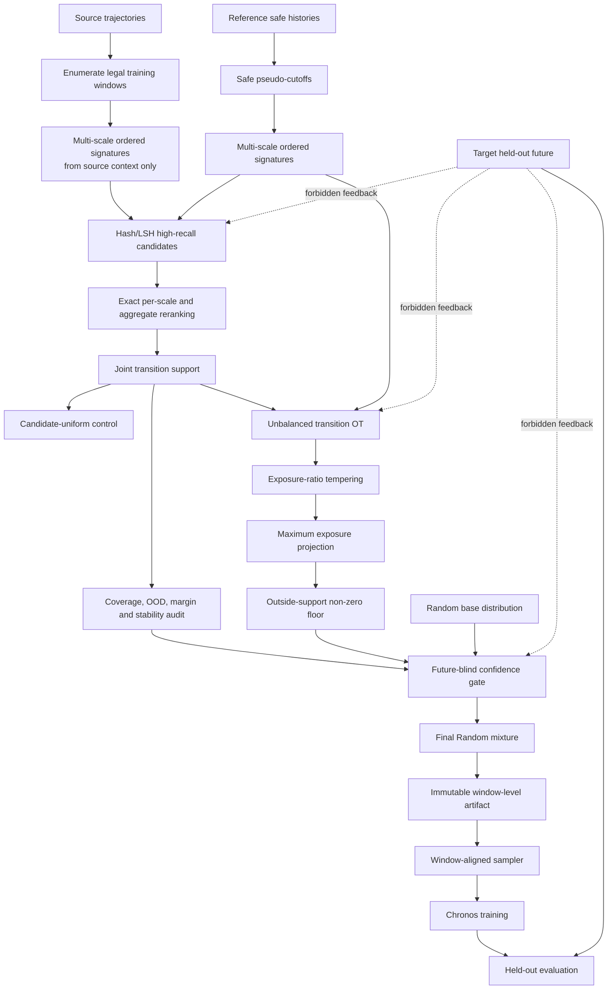

# Boundary-Aware Multi-Scale Transition Optimal Transport

> 历史归档：保留当时的设计、操作或实验证据，不作为当前执行指令。当前入口见 `docs/README.md`。

> 工作名称：**Boundary-Aware Multi-Scale Transition Optimal Transport（BAMT-OT）**
>
> 文档性质：论文方法设计与实现前契约，不代表实验结论已经成立
>
> 核心目标：选择与目标任务具有相似**有序变化模式**的源训练窗口，同时显式限制错误筛选和错误质量分配造成的负迁移

## 1. 方法摘要

现有 static OT 方法首先把参考数据和源数据压缩为单段静态描述，再用距离构造候选支持集，并在支持集内通过 OT 分配采样质量。已有实验显示，该方法的收益和风险来自两个可以分离的环节：

1. **候选支持集选择**：只保留被判定为与参考集相关的源数据；
2. **候选内质量分配**：进一步根据 OT 结果改变这些候选被采样的相对概率。

候选筛选通常比完整 OT 更稳定，但并非始终受益；完整 OT 有时能放大收益，也可能在支持集已经合理时造成显著回退。现有结果还显示，参考特征越分散、候选支持越宽，负迁移风险往往越高；但目前尚无一个可用指标能够可靠解释为什么同一支持集上的 OT 质量分配会优于或劣于 uniform。

BAMT-OT 不把这一问题处理为“寻找一个更强的静态特征”，而把它重新定义为三个相互独立、可审计的问题：

- **候选语义**：源数据与参考数据的起始状态、变化方向、变化形态和时间顺序是否相似；
- **质量可信度**：OT 给出的相对质量峰是否有足够证据，还是只是在不确定条件下过度自信；
- **适用边界**：当参考异质、候选过宽、跨尺度不稳定或采样过度集中时，方法是否应平滑、限幅或退回 Random。

新方法使用同一安全时间截点之前的多尺度连续双段构造有序 transition signature；Hash/LSH 仅用于高召回粗检索，最终候选资格由精确联合 transition distance 决定；候选内 OT 之后依次执行相对基础分布的温度平滑、最大暴露约束和支持外非零底质量；最后由完全 future-blind 的可信度指标决定与 Random 的混合系数。完整实现以**合法训练窗口**为质量分配单位，保证方法规划的 transition 与训练时实际交付的数据一致。

## 2. 当前 static OT 的核心缺陷

### 2.1 静态特征相似不等于预测条件相似

当前方法的逻辑近似为：

\[
X_{\mathrm{history}}
\xrightarrow{h}
z\in\mathbb{R}^{16}
\xrightarrow{d(z_s,z_r)}
\text{support / OT mass}
\xrightarrow{\text{sampling}}
\text{training windows}.
\]

这里真正被匹配的是描述符边缘分布：

\[
p_{\mathrm{weighted\ source}}(z)\approx p_{\mathrm{reference}}(z),
\]

而模型需要的是更接近目标任务预测机制的数据：

\[
p_s(Y\mid X)\approx p_r(Y\mid X).
\]

即使两个历史片段的均值、波动、频域或趋势统计接近，它们后续的变化机制也可能不同。因此，“描述符距离更小”“OT 收敛”或“参考分布被更好覆盖”都不能直接证明训练效用更高。

### 2.2 当前方法同时进行了重采样和硬筛选

当 \(\lambda=1\) 时，支持集外源 segment 的采样概率可以严格等于零。此时方法并非只是在原分布上调整权重，而是在执行：

\[
\text{原始源分布}
\longrightarrow
\text{硬候选删除}
\longrightarrow
\text{候选内重新加权}.
\]

只要候选判断出现错配，所有被删除数据潜在的正迁移机会都会永久消失。参考越异质、支持越宽或匹配越不确定，硬筛选就越可能同时丢失互补机制和训练多样性。

### 2.3 支持集收益与 OT 质量收益被混在一起

如果只比较 Random 与完整 OT，观测到的增益无法区分来自：

- 删除了明显无关的数据；
- 候选集本身更适合目标任务；
- OT 在相同候选内找到了更好的质量排序；
- 仅仅因为分布更尖锐、训练重复度更高；
- planner 质量与实际 sampler 交付窗口之间的偶然偏差。

因此，**同支持集 candidate-uniform** 是不可缺少的因果对照，而不是附属 baseline。

### 2.4 OT 峰值缺少可信度约束

OT 能在给定代价和正则化下给出确定的最优传输计划，但“优化问题有唯一或稳定解”不等于“代价能够代表预测价值”。当代价语义错误或参考覆盖不足时，尖锐质量峰只会把局部错误放大为更高的训练暴露。

### 2.5 segment 质量不等于实际训练窗口质量

当前采样链路包含：

\[
\text{trajectory}
\rightarrow
\text{AnalysisSegment}
\rightarrow
\text{legal window start}
\rightarrow
\text{delivered window}.
\]

一个 segment 的计划质量可能通过跨段窗口、合法起点数量、轨迹归一化和 sampler 行为，被映射为完全不同的窗口暴露。若只在 segment 粒度验证分布，就可能声称“选择了某种 transition”，但训练实际看到的是另一种 transition。

## 3. 旧 Dynamic Segment 为什么没有验证新假设

旧 Dynamic Segment 的直觉是同时观察“当前 segment”和“下一个 segment”，并把变化相似性加入质量分配。但其失败不能直接推导出“动态变化模式无效”，因为旧设计仍有三个结构性混杂。

### 3.1 先静态筛选，再动态加权

旧方法先依据当前静态 segment 形成候选，再在候选内部利用后继 segment 分配质量：

\[
\text{static current-state filter}
\rightarrow
\text{future-transition weighting inside support}.
\]

若第一阶段已经删除了状态不同、但变化机制相似的源候选，第二阶段无法恢复它们。动态质量只能在可能已错配的支持集上进一步集中，因此可能放大第一阶段误差。

### 3.2 固定粗尺度导致边界和相位错位

“当前 512 + 下一个 512”把 transition 绑定在固定 segment 边界上。相同变化可能发生在 segment 内部、跨越边界，或具有明显不同的时间尺度。固定 512 的比较会把真实机制差异和人为切段相位混在一起。

### 3.3 pair 质量折回 anchor，交付窗口不保证对齐

旧 Dynamic 可以对 \((\text{current},\text{next})\) pair 计算质量，但训练 sampler 最终可能只接收 anchor segment 的质量，并从中随机产生任意合法窗口。这样，训练真正看到的 context 并不一定覆盖被比较的有序 pair。

历史结果中，旧 Dynamic 相对 static OT 仅在 70 个可配对点中的 11 个更优，平均相对变化约为 \(-15.03\%\)；向 Random 退火能部分修复。这更支持“错误动态匹配叠加集中质量会放大风险”，而不能否定“直接、对齐地匹配变化模式”这一假设。

## 4. 现有证据如何启发新设计

当前实验线索应被理解为机制假设，而不是最终因果证明：

| 现象 | 暂定解释 | 新方法响应 |
|---|---|---|
| 参考特征 std 越大，提升往往越差 | 参考分布可能混合多个机制，单一传输计划不可靠 | reference heterogeneity 进入适用边界和回退 gate |
| 支持集越大、越分散，提升往往越差 | 候选语义不纯，筛选失去选择性 | 多尺度精确重排；支持覆盖作为风险指标而非越大越好 |
| 支持外质量为零 | 错配会完全抹杀未选数据的收益机会 | 永久保留支持外非零底质量 |
| candidate-uniform 通常比完整 OT 稳定 | 候选语义可能有用，质量峰未必可信 | 必须分开报告 support gain 和 allocation gain |
| task-04 完整 OT 相对同支持 uniform 强回退 | 候选可用但质量排序或集中度有害 | ratio tempering、cap、可信度混合 |
| task-05 支持集本身失败，但 OT 质量部分补救 | 支持集中混有好坏候选，质量分配可能仍有辨别力 | 不把 uniform 稳定性误写成 OT 永远无用 |
| task-17 支持集和完整 OT 都受益 | 候选语义与质量排序可能同时正确 | 保留 \(\lambda_{conf}=1\) 的高置信路径 |

由此形成核心猜想：

> OT 是否有效，取决于参考数据是否由相对一致的变化机制构成、候选是否在多个时间尺度上表达同一有序 transition，以及 OT 的质量集中是否得到独立证据支持。负迁移主要发生在“参考机制不一致—候选过宽或不稳定—质量峰仍然过于自信—支持外数据被清零”的联合条件下。

## 5. 研究问题、假设与贡献边界

### 5.1 研究问题

1. 直接匹配多尺度有序 transition，是否比静态 descriptor 候选更能预测训练效用？
2. 在同一 transition 支持集上，OT 质量何时优于 candidate-uniform，何时造成负迁移？
3. 不使用目标 held-out future 的条件下，能否提前识别 OT 的适用边界并可靠回退 Random？
4. 支持外底质量、峰值平滑和最大暴露约束，能否在保留正迁移的同时降低最坏回退？

### 5.2 可证伪假设

- **H1：候选语义假设。** BAMT candidate-uniform 相对 static candidate-uniform 在多数代表任务上有更高或更稳定的效用。
- **H2：质量条件有效假设。** BAMT-OT 相对 BAMT candidate-uniform 的收益只出现在 reference consistency、跨尺度稳定性和 source 可辨识性较高的任务。
- **H3：安全边界假设。** future-blind gate 能降低完整 OT 的负迁移尾部，同时不把所有任务退化为 Random。
- **H4：交付一致性假设。** planned transition 质量与实际 delivered-window 分布一致；若不一致，训练结果不能用于支持 H1–H3。

### 5.3 论文贡献边界

论文贡献不是 Hash、PAA、Huber distance 或标准 Sinkhorn 本身。候选贡献应被表述为：

1. 以多尺度、有顺序、窗口对齐的 transition 为数据选择对象；
2. 将支持选择、质量分配和适用边界显式拆开；
3. 用结构性 coverage floor、暴露限制和可信度回退构造可拒绝的安全选择机制；
4. 通过 matched-support 和 matched-concentration 对照定位收益与负迁移来源。

## 6. 数据单位、符号与泄漏边界

### 6.1 基本单位

- 源数据轨迹：\(x^{(s)}_{1:T_s}\)；
- 参考任务安全历史：\(x^{(r)}_{1:T_r}\)；
- 参考 pseudo-cutoff：\(t_r\)，必须位于模型选择时可见的历史内；
- 预测 context length：\(L_c=512\)；
- prediction length：\(L_y=64\)；
- 一个合法源训练窗口：

\[
w_i=\left(x^{(s)}_{t_i-L_c:t_i},\;x^{(s)}_{t_i:t_i+L_y}\right).
\]

候选匹配只可使用 context 及其内部的安全切分；源 future \(x^{(s)}_{t_i:t_i+L_y}\) 仅作为正常训练标签，不进入候选距离、可信度 gate 或超参数选择。

### 6.2 禁止信息

以下信息不得进入 candidate、OT cost、temperature、cap、\(\delta_{out}\) 或 \(\lambda_{conf}\) 的选择：

- 目标任务测试区间；
- 目标任务真实预测标签；
- 当前任务 held-out SQL/WQL；
- 使用目标结果挑选出的 checkpoint 或阈值；
- 由测试结果反向构造的任务类别。

阈值只能在 discovery tasks 上确定，然后冻结到 confirmation tasks；样本不足时至少使用 leave-one-task-family-out。

## 7. 多尺度有序 Transition Signature

### 7.1 尾部对齐的连续双段

对任意安全 cutoff \(t\) 和尺度 \(\ell\in\mathcal L\)，定义：

\[
A_\ell(t)=x_{t-2\ell:t-\ell},\qquad
B_\ell(t)=x_{t-\ell:t}.
\]

所有尺度共享同一 cutoff。默认尺度集合：

\[
\mathcal L=\{32,64,128,256\}.
\]

这组表示同时保留：

- \(A_\ell\)：变化发生前的起始状态；
- \(B_\ell\)：最近状态；
- \(A_\ell\rightarrow B_\ell\)：变化方向和顺序；
- 多个 \(\ell\)：局部变化与较长期变化是否一致。

### 7.2 联合 robust normalization

对 \([A_\ell,B_\ell]\) 作为一个整体计算中心和尺度，例如：

\[
m_\ell=\operatorname{median}([A_\ell,B_\ell]),
\]

\[
s_\ell=\max\left(1.4826\cdot
\operatorname{median}|[A_\ell,B_\ell]-m_\ell|,\epsilon_s\right),
\]

\[
\bar A_\ell=(A_\ell-m_\ell)/s_\ell,\qquad
\bar B_\ell=(B_\ell-m_\ell)/s_\ell.
\]

不得分别对 \(A_\ell\) 和 \(B_\ell\) 独立归一化。独立归一化会消除二者之间的 level shift 和 scale change，使“从低位上升到高位”和“形状相同但无变化”变得不可区分。

当联合 MAD 小于 \(\epsilon_s\) 时，设置 near-constant indicator，使用稳定尺度替代，避免数值噪声被无限放大。

### 7.3 默认低维时序表示

第一版不强制使用现有 16D descriptor。对每个标准化块使用固定 \(J=16\) 个 PAA bins：

\[
a_\ell=\operatorname{PAA}_{J}(\bar A_\ell),\qquad
b_\ell=\operatorname{PAA}_{J}(\bar B_\ell),
\]

\[
\Delta_\ell=b_\ell-a_\ell.
\]

再计算三个低维补充量：

\[
u_\ell=\frac{\operatorname{median}(B_\ell)-
\operatorname{median}(A_\ell)}{s_\ell},
\]

\[
v_\ell=\log\frac{\operatorname{MAD}(B_\ell)+\epsilon_s}
{\operatorname{MAD}(A_\ell)+\epsilon_s},
\]

\[
c_\ell=\mathbb 1[s_\ell=\epsilon_s].
\]

单尺度签名为：

\[
\psi_\ell(t)=
[a_\ell,\ b_\ell,\ \Delta_\ell,\ u_\ell,\ v_\ell,\ c_\ell].
\]

PAA 不是论文创新点，其作用是以固定维度近似保留块内顺序。现有 16D descriptor 应保留为 static baseline 和可解释诊断，不应在没有证据时被彻底移除。

### 7.4 精确单尺度距离

对 source \(i\) 与 reference \(j\)，定义组件距离：

\[
d^{start}_{ij\ell}=D_H(a^{(s)}_{i\ell},a^{(r)}_{j\ell}),
\]

\[
d^{end}_{ij\ell}=D_H(b^{(s)}_{i\ell},b^{(r)}_{j\ell}),
\]

\[
d^{change}_{ij\ell}=D_H(\Delta^{(s)}_{i\ell},\Delta^{(r)}_{j\ell}),
\]

其中 \(D_H\) 为逐维 Huber distance 的均值。level、scale 和 constant mismatch 分别由 \(u_\ell,v_\ell,c_\ell\) 计算。

每个组件先使用**仅源数据**随机 pair 距离的 robust scale 校准：

\[
\widetilde d^g=d^g/
\max(\operatorname{median}_{(i,k)\sim source}d^g_{ik},\epsilon_d).
\]

默认单尺度代价：

\[
d_{ij\ell}=
0.20\widetilde d^{start}_{ij\ell}
+0.35\widetilde d^{end}_{ij\ell}
+0.35\widetilde d^{change}_{ij\ell}
+0.05\widetilde d^{level}_{ij\ell}
+0.05\widetilde d^{scale}_{ij\ell}.
\]

起始状态仍有约束作用，但最近状态和有序变化占主要权重。初始实验中这组权重必须冻结，不能逐任务依据结果调节。

### 7.5 多尺度聚合距离

各尺度先独立校准，再等权聚合：

\[
D_{ij}=\frac{1}{|\mathcal L|}
\sum_{\ell\in\mathcal L}d_{ij\ell}.
\]

后续可研究由 reference consistency 决定的尺度权重，但不能在第一版同时学习表示、组件权重、尺度权重和 gate，否则方法自由度过高，无法定位收益来源。

## 8. Hash-Assisted Recall 与精确重排

Hash bin、随机投影或 LSH 仅用于避免对全部 source-reference pair 计算精确距离。其必须满足以下契约：

1. 输入是每尺度的 transition signature，而非 held-out outcome；
2. 目标是高 recall，不直接决定最终候选；
3. Hash collision 只产生待检查候选，不能被解释为语义匹配；
4. 最终资格和排序必须由上一节的精确 \(D_{ij}\) 决定；
5. 必须在小规模 exact search 上报告 recall@K，证明工程近似没有改变方法结论。

默认检索预算：

- 每尺度 Hash/LSH 粗召回 \(M=4096\)；
- 每尺度精确 guard top-\(k_g=32\)；
- 聚合候选 top-\(K=256\)。

不得使用所有尺度 top-K 的严格交集。严格交集会系统性删除只在局部尺度或长期尺度上匹配的有效候选，并重新引入“前置硬筛选不可恢复”的问题。

## 9. Joint Transition Support

对每个 reference pseudo-cutoff \(j\)：

1. 在每个尺度 \(\ell\) 上进行高召回粗检索；
2. 用精确 \(d_{ij\ell}\) 重排该尺度候选；
3. 取每尺度 guard top-\(k_g\) 的并集 \(G_j\)；
4. 在 \(G_j\) 上计算聚合距离 \(D_{ij}\)；
5. 保留 aggregate top-\(K\)，并保留各尺度少量 guard；
6. 对所有 reference 候选取并集，得到联合支持集 \(C\)。

候选不是“OT 最终只会匹配的唯一真数据”，而是“允许 OT 进一步比较的有限工作集”。因此必须记录：

- \(|C|\) 与 source 总窗口数之比；
- \(C\) 在基础分布 \(p_0\) 下的 raw-mass coverage：

\[
\rho_C=\sum_{i\in C}p_{0,i};
\]

- 每个 reference 是否至少有一个有限距离候选；
- 候选的 trajectory、regime 和时间覆盖；
- 每尺度 top-K 的 Jaccard 稳定性；
- reference bootstrap 后 candidate rank 的稳定性。

支持覆盖不是越大越好。\(\rho_C\) 很小意味着过度删除；很大同时距离分散意味着候选不具选择性。它应与 reference heterogeneity、距离 margin 和跨尺度稳定性联合解释。

## 10. Candidate-Uniform 与 Transition OT

### 10.1 同支持集 candidate-uniform

在支持集 \(C\) 上定义基础条件分布：

\[
p_{C,i}=\frac{p_{0,i}}{\sum_{k\in C}p_{0,k}},\qquad i\in C.
\]

若当前 Random 在合法窗口上均匀，则它退化为 \(1/|C|\)；若 Random 本身包含 trajectory balance，则必须保留该基础几何，不能错误改成 segment uniform。

该分布构成 `bamt-candidate-uniform`。它回答：**仅使用新的 transition 支持集，不使用 OT 质量，是否已经产生收益？**

### 10.2 候选内 OT

在 \(C\) 与 reference pseudo-cutoff 集合 \(R\) 之间使用联合代价矩阵：

\[
\mathbf C_{ij}=D_{ij},\qquad i\in C,j\in R.
\]

沿用当前 unbalanced entropic OT 作为第一版 solver：

\[
\pi^*=\arg\min_{\pi\ge0}
\langle\pi,\mathbf C\rangle
+\varepsilon\operatorname{KL}(\pi\|p_C\otimes r)
+\tau_s\operatorname{KL}(\pi\mathbf1\|p_C)
+\tau_r\operatorname{KL}(\pi^\top\mathbf1\|r),
\]

其中 \(r\) 是 reference 基础质量。候选内 OT 质量为 row marginal 归一化：

\[
q^{OT}_i=
\frac{(\pi^*\mathbf1)_i}
{\sum_{k\in C}(\pi^*\mathbf1)_k}.
\]

solver 收敛、transport cost 降低只证明优化过程有效，不证明训练效用。必须继续通过 candidate-uniform、shuffled-reference 和 matched-concentration 控制来解释。

## 11. 相对基础分布的 Exposure-Ratio Tempering

直接对 \(q^{OT}\) 做 temperature 会在基础分布不均匀时改变 Random/trajectory balance 的语义。BAMT-OT 平滑的是 OT 相对基础条件质量的暴露倍数：

\[
e_i=\frac{q^{OT}_i+\epsilon}{p_{C,i}+\epsilon}.
\]

对温度 \(T\ge1\)：

\[
q_i^{(T)}=
\frac{p_{C,i}e_i^{1/T}}
{\sum_{k\in C}p_{C,k}e_k^{1/T}}.
\]

性质：

- \(T=1\)：近似保留原始 OT；
- \(T>1\)：压平 OT 相对 base 的峰；
- \(T\rightarrow\infty\)：回到候选内 base，即 candidate-uniform；
- 若 \(q^{OT}=p_C\)，任何 \(T\) 都不产生额外变化。

初始温度网格：

\[
T\in\{1,1.25,1.5,2,3,\infty\}.
\]

算法应选择满足 ESS、entropy、top-mass 和 exposure constraints 的最小 \(T\)，即尽量保留 OT 信号，但不能允许未经约束的尖峰。

## 12. Maximum Exposure Projection

对候选 \(i\) 定义质量上界：

\[
u_i=\min(R_{max}p_{C,i},M_{max}),
\]

其中：

- \(R_{max}\) 限制相对 base 的最大暴露倍数，初始建议 \(R_{max}=16\)；
- \(M_{max}\) 限制任何单个窗口的绝对质量，需由目标最小 ESS 或最大 top-1 mass 转换确定。

将 \(q^{(T)}\) 投影到受限 simplex：

\[
q^{cap}=\arg\min_{q}
\operatorname{KL}(q\|q^{(T)})
\quad\text{s.t.}\quad
\sum_iq_i=1,\;0\le q_i\le u_i.
\]

实现使用 deterministic water-filling / KL projection，并记录被 cap 的元素数和重分配质量。如果 \(\sum_i u_i<1\)，约束不可行，禁止静默放宽上界；应按顺序：

1. 增大温度；
2. 回到候选内 base；
3. 若候选内 base 仍违反结构约束，回退完整 Random。

## 13. 支持集外非零底质量

定义支持外基础条件分布：

\[
p_{out,i}=\frac{p_{0,i}}
{\sum_{k\notin C}p_{0,k}},\qquad i\notin C.
\]

受约束候选质量与支持外底质量组合为：

\[
q_i^{floor}=
\begin{cases}
(1-\delta_{out})q^{cap}_i,&i\in C,\\
\delta_{out}p_{out,i},&i\notin C.
\end{cases}
\]

初始建议：

\[
\delta_{out}=0.05,
\]

并固定测试 \(\{0.01,0.05,0.10\}\) 的敏感性。

\(\delta_{out}\) 与后面的 \(\lambda_{conf}\) 不是同一个参数：

- \(\delta_{out}\) 是结构性的 coverage floor，保证即使方法被完全启用，支持外仍有非零机会；
- \(\lambda_{conf}\) 是任务级可信度，决定整体上相信 BAMT-OT 还是 Random；
- 前者防止“选错即永久删除”，后者防止“整体证据不足仍强行使用”。

当 \(C\) 已覆盖全部合法窗口时，不存在支持外集合，应令 \(q^{floor}=q^{cap}\)，同时把“候选失去选择性”作为 gate 风险而不是伪造底质量。

## 14. Future-Blind Confidence Gate 与 Random 回退

最终分布定义为：

\[
q^{final}=(1-\lambda_{conf})p_0+
\lambda_{conf}q^{floor},
\qquad \lambda_{conf}\in[0,1].
\]

### 14.1 第一版已有信号

第一版 gate 优先使用当前分析已存在或容易稳定计算的指标，避免先引入复杂 learned gate：

1. **Reference heterogeneity**：参考 signature 的平均 pairwise robust distance、各维 robust std 或聚类分离度；
2. **Support raw-mass coverage** \(\rho_C\)：候选占原始可采样质量的比例；
3. **Planned concentration**：window-level ESS、归一化 entropy、top-1/top-10/top-1% mass；
4. **Unsupported reference ratio**：没有足够近 source 候选的 reference 比例；
5. **Regime/trajectory coverage**：最终质量覆盖的轨迹和变化模式数量。

### 14.2 新表示自然提供的信号

1. **Cross-scale agreement**：不同尺度 top-K 的 Jaccard、rank correlation；
2. **Reference bootstrap stability**：重采样 reference 后候选和质量排名的稳定性；
3. **Source conditional ambiguity**：相同 reference 附近是否存在许多距离接近但 transition 冲突的 source；
4. **Reference-to-source OOD**：reference 最近邻距离相对 source-source calibration 的分位数；
5. **Distance margin**：第 K 名附近是否存在清楚边界，或候选排名是否几乎不可辨。

这些指标定义的是“当前证据是否足以支持选择”，不是直接预测最终 SQL 的 oracle。

### 14.3 第一版低自由度规则

先由 discovery tasks 冻结 reference heterogeneity 和 support coverage 的高风险阈值。定义：

| Reference 风险 | Support 风险 | \(\lambda_{max}\) |
|---|---:|---:|
| 低 | 低 | 1.00 |
| 高 | 低 | 0.50 |
| 低 | 高 | 0.50 |
| 高 | 高 | 0.00 |

然后在：

\[
\lambda_{conf}\in\{0,0.25,0.5,0.75,1\}
\]

中选择不超过 \(\lambda_{max}\)，且满足以下冻结约束的最大值：

- window-level normalized ESS 不低于阈值；
- normalized entropy 不低于阈值；
- top-1/top-1% mass 不高于阈值；
- trajectory/regime coverage 不低于阈值；
- planned-versus-delivered divergence 不高于阈值。

如果没有正 \(\lambda\) 可行，必须令 \(\lambda_{conf}=0\)，完整回退 Random。论文方法必须允许“拒绝使用 OT”，否则无法真正定义适用边界。

### 14.4 后续 learned gate 的限制

只有当固定 gate 已显示稳定单调关系后，才允许使用低容量模型学习 \(\lambda_{conf}\)。训练样本必须按任务家族拆分，输入只能包含 future-blind 指标，输出标签只能来自独立 discovery 结果。不能以 20 个任务上的逐任务最优方法直接训练和评估同一个 gate。

## 15. Planner 与 Delivery 对齐

### 15.1 完整实现的质量单位

完整 BAMT-OT 必须直接为合法训练窗口 \(w_i\) 建立 signature 和质量。对窗口 cutoff \(t_i\)，所有 \(A_\ell,B_\ell\) 均取自其 512 context 内，训练 future 只用于损失：

\[
\underbrace{x_{t_i-512:t_i}}_{\text{selection-visible context}}
\rightarrow
\psi_i,
\qquad
\underbrace{x_{t_i:t_i+64}}_{\text{training label only}}.
\]

这样，被选择的 transition 与模型真正接收的 context 是同一个窗口。

### 15.2 segment-proxy 原型

若计算成本要求先在 AnalysisSegment 粒度实现，必须明确命名为 **segment-proxy BAMT-OT**，不得直接声称已经完成 transition-aligned selection。至少审计三层分布：

1. planned signature/segment mass；
2. induced legal-window-start mass；
3. actual delivered-window mass。

需要报告三层的 ESS、entropy、top-mass、trajectory coverage，并计算 planned 与 delivered 的 total variation 或 Jensen-Shannon divergence。只有 delivery fidelity 达到预设阈值后，segment-proxy 结果才能用于机制分析。

## 16. 完整算法

### 16.1 离线规划算法

**输入**：源轨迹、参考安全历史、合法窗口定义、冻结尺度与距离权重、OT 参数、安全约束、Random 基础分布 \(p_0\)。

**输出**：不可变的 window-level `sampling.safetensors`、manifest、候选与质量审计指标。

1. 枚举全部合法源训练窗口及其稳定 ID；
2. 在参考安全历史内生成冻结规则的 pseudo-cutoff；
3. 对 source window cutoff 和 reference cutoff 构造多尺度 \((A_\ell,B_\ell)\)；
4. 对每个 pair 联合 robust normalization，并计算 \(\psi_\ell\)；
5. 使用 source-only pair distance 校准每个 distance component；
6. 为每尺度建立 Hash/LSH 高召回索引；
7. 对每个 reference 每尺度召回 \(M\) 个候选并精确重排；
8. 合并 per-scale guard，计算多尺度聚合距离；
9. 构造 joint support \(C\)，记录 coverage、OOD、margin 和稳定性；
10. 生成 `bamt-candidate-uniform` 的 \(p_C\)；
11. 在 \(C\times R\) 上运行 unbalanced entropic OT，得到 \(q^{OT}\)；
12. 从最小温度开始进行 exposure-ratio tempering；
13. 对每个温度执行 maximum-exposure projection；
14. 选择首个满足 concentration constraints 的 \(q^{cap}\)；
15. 注入支持外底质量 \(\delta_{out}\)，得到 \(q^{floor}\)；
16. 根据 future-blind gate 计算 \(\lambda_{max}\)；
17. 在冻结 grid 中选取最大可行 \(\lambda_{conf}\)；
18. 与 \(p_0\) 混合得到 \(q^{final}\)；
19. 检查非负、归一化、有限值、稳定 ID 对齐和 determinism；
20. 写出不可变 artifact、配置哈希、输入 manifest 和全部审计指标。

### 16.2 训练时算法

1. 加载并严格校验 artifact 与当前数据、窗口几何和任务配置；
2. 按 \(q^{final}\) 抽取稳定 window ID；
3. 从该 ID 直接构造唯一对应的 context/future；
4. 记录 `slot_scheduled`、`window_selected`、`slot_delivered`、`batch_finalized`；
5. 定期比较计划分布和交付分布；
6. 正常执行 Chronos 训练，不在线读取目标 held-out outcome；
7. 使用冻结 checkpoint 和统一 protocol 进行 held-out evaluation。

### 16.3 伪代码

```text
source_windows = enumerate_legal_windows(source, context=512, pred=64)
reference_cutoffs = build_safe_pseudo_cutoffs(reference_history)

source_sig = multiscale_ordered_signature(source_windows.context)
reference_sig = multiscale_ordered_signature(reference_cutoffs.history)
calibration = fit_source_only_distance_scales(source_sig)

support = empty_set()
for reference in reference_sig:
    guards = empty_set()
    for scale in [32, 64, 128, 256]:
        recalled = hash_recall(reference[scale], budget=4096)
        ranked = exact_scale_rerank(recalled, reference, calibration)
        guards = guards union top_k(ranked, 32)
    aggregate_ranked = exact_multiscale_rerank(guards, reference, calibration)
    support = support union top_k(aggregate_ranked, 256) union guards

p_candidate = condition_base_distribution(p_random, support)
q_ot = unbalanced_ot(support, reference_sig, joint_transition_cost)

for temperature in [1, 1.25, 1.5, 2, 3, infinity]:
    q_temp = temper_exposure_ratio(q_ot, p_candidate, temperature)
    q_cap = kl_project_with_exposure_cap(q_temp)
    if concentration_constraints_hold(q_cap):
        break
else:
    q_cap = p_candidate

q_floor = add_outside_support_floor(q_cap, p_random, delta_out=0.05)
lambda_max = future_blind_boundary_gate(reference_sig, support, q_floor)
lambda_conf = largest_feasible_lambda(lambda_max, q_floor, p_random)
q_final = (1 - lambda_conf) * p_random + lambda_conf * q_floor

write_immutable_window_sampling_artifact(q_final, diagnostics, hashes)
```

## 17. 方法 DAG



## 18. 与现有方法的结构差异

| 维度 | Static OT | 旧 Dynamic Segment | BAMT-OT |
|---|---|---|---|
| 候选语义 | 单段静态 16D descriptor | 先静态 current 筛选 | 直接用有序连续双段联合筛选 |
| 时间尺度 | 固定 AnalysisSegment | 固定 current 512 + next 512 | 尾部对齐的 32/64/128/256 多尺度 |
| 动态信息位置 | 无 | 已筛候选内质量分配 | 候选距离和 OT cost 从一开始共享同一 transition 语义 |
| 多尺度合并 | 无 | 无 | per-scale guard 并集 + aggregate rerank |
| Hash 作用 | 可选检索 | 无明确契约 | 仅高召回工程层，不决定最终资格 |
| 候选内对照 | candidate-uniform 可用 | 通常缺失 | 强制同支持 candidate-uniform |
| 峰值控制 | Sinkhorn/\(\lambda\) 间接控制 | anneal 部分回退 | ratio temperature + explicit cap |
| 支持外概率 | \(\lambda=1\) 时可为 0 | 可为 0 | \(\delta_{out}>0\) 的结构性底质量 |
| 任务级拒绝 | 固定或手调 \(\lambda\) | 退火 | future-blind gate，可完全回退 Random |
| 规划单位 | segment | pair 质量可能折回 anchor | 完整方法为 legal window |
| 训练交付保证 | 需间接审计 | transition 可能不对齐 | stable window ID 直接交付 |

## 19. 参数、冻结规则与自由度控制

### 19.1 第一版冻结默认值

| 参数 | 初始值 |
|---|---:|
| context / prediction | 512 / 64 |
| scales \(\mathcal L\) | 32, 64, 128, 256 |
| PAA bins \(J\) | 16 |
| component weights | 0.20 / 0.35 / 0.35 / 0.05 / 0.05 |
| Hash recall budget \(M\) | 4096 per scale |
| aggregate K | 256 |
| per-scale guard | 32 |
| temperature grid | 1, 1.25, 1.5, 2, 3, infinity |
| relative exposure cap \(R_{max}\) | 16 |
| outside floor \(\delta_{out}\) | 0.05 |
| confidence grid | 0, 0.25, 0.5, 0.75, 1 |

### 19.2 参数研究顺序

必须按机制顺序逐步解冻：

1. 固定表示和 OT，只比较 static support 与 BAMT support；
2. 固定 BAMT support，比较 candidate-uniform 与原始 OT；
3. 固定 support 和 OT，加入 temperature/cap；
4. 固定安全质量，加入 \(\delta_{out}\)；
5. 最后验证 gate；
6. 只有以上成立后，才比较尺度集合、PAA bins 或 learned representation。

禁止一次性大规模搜索所有参数后报告最优结果，这会使边界发现变成任务结果拟合。

## 20. 最小六方法实验矩阵

| ID | 方法 | 回答的问题 |
|---:|---|---|
| 1 | `rand` | 原始训练分布基线 |
| 2 | `static-candidate-uniform` | 当前 static 支持集本身是否有用 |
| 3 | `static-ot` | 当前支持集内 OT 质量是否额外有用 |
| 4 | `bamt-candidate-uniform` | transition 候选是否优于 static 候选 |
| 5 | `bamt-ot` | transition 支持集内原始 OT 质量的收益与风险 |
| 6 | `bamt-safe-selective` | 平滑、cap、底质量和 gate 能否降低负迁移 |

核心比较必须预先固定：

- **4 vs 2**：只改变候选语义，检验 transition support；
- **5 vs 4**：同候选比较质量分配，检验 allocation gain；
- **6 vs 5**：检验安全约束和适用边界；
- **6 vs 1**：检验完整方法是否真正优于 Random；
- **3 vs 2**：复现 static OT 的支持与质量分解；
- **5 vs 3**：仅在前述分解成立后解释整体方法差异。

所有比较应在相同模型、任务、训练预算、checkpoint、seed、数据版本和 evaluation protocol 下进行。

## 21. 必需的机制控制实验

### 21.1 Matched-Support

在完全相同的候选 ID 上比较 base conditional mass、OT mass 和安全质量，隔离 allocation effect。

### 21.2 Matched-Concentration Random

构造与 OT 具有相近 ESS、entropy、top-mass 和分层覆盖，但与 reference 无关的随机质量。若它也产生相同收益，则收益可能来自训练重复度或优化动态，而非匹配语义。

不能只匹配一个标量 ESS；应尽可能同时匹配完整暴露形状和同一粒度的 trajectory/window coverage。

### 21.3 Shuffled-Reference OT

使用 reference 数量和异质性相近、但任务身份打乱的参考集运行同一 pipeline。若 shuffled reference 与真实 reference 表现接近，则 OT 的任务条件信息不足。

### 21.4 Matched-Coverage

比较不同候选方法时固定 raw-mass coverage 或 K，区分“transition 语义更好”与“仅仅候选更少”。

### 21.5 Lambda、Temperature 与 Floor 分解

分别固定其他部分，仅改变：

- \(\lambda_{conf}\)：整体任务可信度；
- \(T\)：候选内 OT 偏置强度；
- \(\delta_{out}\)：支持外保险质量；
- \(R_{max}\)：单样本最大暴露。

这些参数含义不同，不应只用一个 lambda 吸收全部风险。

### 21.6 Planner–Delivery Audit

比较 planned 与 delivered 的 window ID、transition signature 分布、ESS、entropy 和 coverage。该控制失败时，应停止解释下游训练结果。

## 22. 代表任务与扩展顺序

第一阶段选择机制上互补的任务，而不是只选择方法已经表现好的任务：

- **task-04**：候选支持有一定价值，但完整 OT 相对同支持 uniform 出现强回退，用于检验质量平滑和 cap；
- **task-05**：支持集本身失败，而 OT 质量部分补救，用于检验“uniform 更稳定但不总是更好”；
- **task-17**：支持集与完整 OT 都受益，用于检验安全机制是否过度保守；
- 另加入一个参考高 std、候选覆盖宽的明显负迁移任务；
- 另加入一个接近 Random 的中性任务，防止边界只区分极端案例。

扩展顺序：

1. 在代表任务上只做 cache/audit，不训练，确认候选与质量机制；
2. 小预算训练验证方向和 delivery fidelity；
3. 冻结参数与 gate；
4. 扩展全部 20 tasks × 统一 checkpoints；
5. 在 confirmation split 上报告总体均值、win rate、worst-case regression 和任务级完整轨迹。

task-04/05/17 是 outcome-informed 的机制发现样本，不能同时作为无偏确认集。

## 23. 成功、失败与止损标准

### 23.1 候选机制成功

只有当 `bamt-candidate-uniform` 相对 `static-candidate-uniform` 在冻结 confirmation protocol 下改善平均表现或显著降低负迁移尾部，且 matched-coverage 后仍成立，才能声称 transition support 更有效。

### 23.2 OT 质量机制成功

只有当 `bamt-ot` 相对 `bamt-candidate-uniform` 的收益与预注册的 consistency/stability 指标呈可重复关系，并超过 matched-concentration Random，才能声称 OT 质量包含额外任务条件信息。

### 23.3 安全机制成功

`bamt-safe-selective` 应同时满足：

- worst-task 或低分位回退明显小于 `bamt-ot`；
- 正收益任务没有全部退回 Random；
- gate 的风险分数与负迁移方向在 confirmation tasks 上保持一致；
- 结果不是依赖逐任务调参得到。

### 23.4 失败和止损

满足任一条件，应停止扩展复杂表示：

- BAMT support 在 matched-coverage 下不优于 static support；
- Hash exact-recall 不足，或近似误差改变候选结论；
- planned 与 delivered 分布持续不一致；
- reference consistency 与收益/回退无可重复关系；
- safe method 仅通过令所有 \(\lambda_{conf}=0\) 获得稳定性；
- matched-concentration Random 解释了大部分所谓 OT 收益；
- 结果只在少数 outcome-informed 任务和 checkpoint 上成立。

此时论文应收缩为“数据选择负迁移的机制与适用边界研究”，而不是继续增加编码器或检索复杂度。

## 24. Artifact、Cache 与 Determinism 契约

每个方法 artifact 至少记录：

- source/reference catalog hash；
- stable legal-window ID schema；
- context、prediction、scale、PAA 和 normalization 配置；
- Hash 实现、seed、bucket 配置和 exact recall audit；
- distance component calibration 统计；
- candidate IDs、per-scale rank、aggregate rank 和 \(\rho_C\)；
- OT solver、dtype、block size、\(\varepsilon,\tau_s,\tau_r\)、迭代与收敛信息；
- \(q^{OT},q^{(T)},q^{cap},q^{floor},q^{final}\) 的摘要与哈希；
- temperature、cap、\(\delta_{out}\)、\(\lambda_{max}\)、\(\lambda_{conf}\) 及选择原因；
- window/trajectory-level ESS、entropy、top-mass、coverage；
- reference heterogeneity、OOD、margin、跨尺度和 bootstrap 稳定性；
- planner-delivery audit 所需映射；
- 代码 commit、配置文件 hash 和生成时间。

严格校验以下不变量：

\[
q_i\ge0,\qquad \sum_iq_i=1,\qquad q_i<\infty,
\]

并保证相同输入、配置、seed 和代码 commit 生成 byte-stable 或数值容差内等价的 artifact。任何窗口几何、catalog、reference cutoff 或 policy 变化都必须使旧 cache 失效，禁止静默复用。

## 25. 论文叙事与不能声称的内容

### 25.1 推荐叙事

> 静态相似性驱动的数据选择可以提高时间序列基础模型适配效率，但它把描述符接近误当成预测机制接近，并可能通过硬支持筛选和尖锐质量分配造成负迁移。我们提出 BAMT-OT：它直接比较安全历史中的多尺度有序 transition，将支持选择与候选内质量分配拆分，并通过暴露平滑、最大质量、支持外底质量和 future-blind confidence gate 显式定义方法的适用边界。该方法不是假设 transfer 总是有效，而是在证据不足时拒绝 transfer 并回退 Random。

论文最有价值的结果不一定是“所有任务平均提升最大”，而可能是：

1. 证明候选筛选和 OT 质量是两个独立收益/风险来源；
2. 证明静态状态相似性不足，有序 transition 更接近有效选择语义；
3. 给出无需目标未来的适用边界指标；
4. 在保留上行收益的同时显著压缩最坏负迁移。

### 25.2 当前不能声称

- 不能声称 OT 在全部或绝大多数任务上必然提升；
- 不能把当前相关性写成因果机制；
- 不能声称 reference std 或 support size 单独就能可靠选择 uniform/OT；
- 不能用 solver convergence、低 transport cost 或低 descriptor distance 证明预测效用；
- 不能把 Hash/LSH 描述为主要算法创新；
- 不能在 segment-proxy 尚未验证交付一致性时声称完成 window-aligned transition selection；
- 不能使用 task-04/05/17 同时发现规则并验证规则；
- 不能隐藏回退 Random 的任务比例；适用边界本身就是方法结果的一部分。

## 26. 最终方法判定链

BAMT-OT 的完整判定逻辑可以压缩为：

```text
变化模式是否在多个尺度上相似？
  ├─ 否：不进入主要候选，仅保留支持外基础概率
  └─ 是：进入 joint transition support
        ↓
同一支持集内，OT 是否给出稳定且不过度集中的额外证据？
  ├─ 否：回到 candidate-uniform 或提高 temperature
  └─ 是：保留受 cap 约束的 OT 相对暴露
        ↓
参考一致性、支持覆盖和交付多样性是否处于可信边界内？
  ├─ 否：降低 lambda_conf，必要时完全回退 Random
  └─ 是：启用完整 BAMT-OT
```

这使方法的核心从“OT 总能找到更好的训练数据”转为一个更可验证的命题：

> **只有当有序变化模式匹配、质量证据稳定且数据覆盖没有被危险压缩时，才允许 OT 改变训练分布；否则保留原分布的学习机会。**
