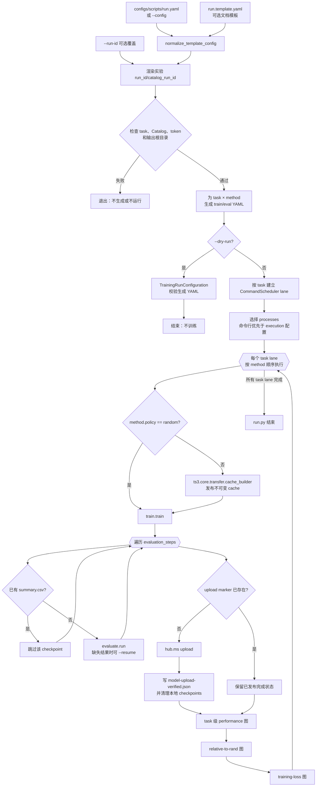
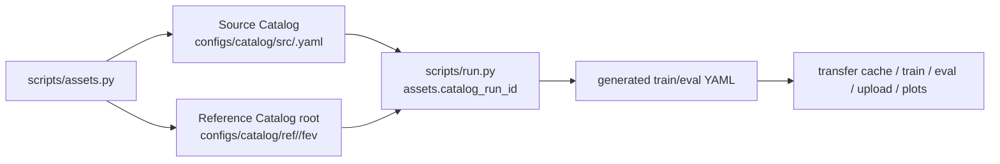

# SOP-3：AnaSeg 资产重建与 FEV 训练工作流

> 历史归档：保留当时的设计、操作或实验证据，不作为当前执行指令。当前入口见 `docs/README.md`。

> 历史 SOP：旧 AnaSeg/Catalog 工作流及 scripts/run.py 已退役，以下命令不再是操作入口。
> 当前工具见 [scripts/STD.md](../../../scripts/STD.md)，安装见 [requ/INSTALL.md](../../../requ/INSTALL.md)。

本 SOP 说明 `scripts/assets.py` 与 `scripts/run.py` 的职责边界、配置方式、命令行用法、
产物路径和失败恢复规则。所有项目命令均在远端 `/root/TS3`、`ts3` Conda 环境中执行。
资产重建与训练实验必须使用不同的 `run_id` 语义：资产 `run_id` 标识不可变的 Source/
Reference Catalog 版本，实验 `run_id` 只标识本次训练、评估、可视化和上传输出。

## 1. 唯一工作流

```text
Fetch raw（SOP-1 / SOP-1.1）
  -> scripts/assets.py
  -> Source Bundle -> Source Catalog
  -> Reference Bundle（每个 asset 独立）-> Reference Catalogs
  -> scripts/run.py
  -> 每 task/method 的训练与评估 YAML
  -> 非 Random transfer cache
  -> Training checkpoints / loss CSV
  -> Evaluation summary.csv
  -> ModelScope upload marker / checkpoint archive
  -> performance、relative-to-rand、loss 图
```

`scripts/assets.py` 只构建 CPU/I/O 资产，不训练模型、不计算 OT/KDE、不生成 transfer
cache，也不删除已有目录。`scripts/run.py` 只消费已经发布的 Catalog，负责实验编排；它
会在非 Random 方法训练前调用 `ts3.core.transfer.cache_builder`，但不会重新读取 Reference raw、
Bundle 或 Feature。

资产与实验的路径关系如下：

| 标识 | 作用 | 示例 |
| --- | --- | --- |
| 资产 `run_id` | Source/Reference Bundle 与 Catalog 的不可变版本 | `1b-fev-3-segl512s512` |
| 实验 `assets.catalog_run_id` | `run.py` 要消费的资产 `run_id` | `1b-fev-3-segl512s512` |
| 实验 `assets.run_id` | 当前训练/评估/可视化输出命名空间 | `1b-r_sot_sotann-fev-20-segl512s512` |

因此，同一个已验证 Catalog 可以被多个实验复用；实验输出不得写入资产目录，也不得用
实验 `run_id` 反向覆盖已经发布的 Catalog。

## 2. 当前 DAG

以下 DAG 是当前 `scripts/assets.py` 和 `scripts/run.py` 实际编排的逻辑依赖图。脚本使用
子进程顺序执行依赖节点；`run.py` 的不同 task 才会被 `CommandScheduler` 拆成可并发的
lane。图中的虚线表示条件分支，菱形表示脚本在该处进行的存在性或 schema 检查。

### 2.1 `scripts/assets.py` 资产 DAG

```mermaid
flowchart TD
    A[configs/scripts/assets.yaml<br/>或 --config] --> B[读取配置并渲染 {run_id}]
    X[--run-id 可选覆盖] --> B
    B --> C{检查 Source raw<br/>Reference spec/raw}
    C -- 缺失 --> E1[退出：不创建资产]
    C -- 完整 --> D{目标 Bundle/Catalog<br/>是否已存在}
    D -- 是 --> E2[退出：拒绝覆盖]
    D -- 否 --> S1[dataset_processing.load<br/>Source Bundle]
    S1 --> S2[dataset_processing.dedup.src]
    S2 --> S3[dataset_processing.features.src]
    S3 --> S4[dataset_processing.catalog<br/>Source Catalog V6]
    S4 --> R1[dataset_processing.load.ref<br/>asset-id all]
    R1 --> R2{{遍历每个 Reference asset}}
    R2 --> R3[dataset_processing.features.ref]
    R3 --> R4{Reference Catalog<br/>是否已存在}
    R4 -- 是 --> E3[退出：拒绝覆盖]
    R4 -- 否 --> R5[dataset_processing.catalog.ref<br/>一个 asset 一个 Catalog]
    R5 --> R2
    R2 -->|全部 asset 完成| Z[资产重建完成<br/>供 run.py 消费]
```

该 DAG 有两个重要的串行边界：Source 必须完成 Catalog 发布后才进入 Reference 处理；
Reference 则是“加载一次、逐 asset Feature/Catalog”的循环。Reference 的多个 asset 在
当前脚本中不是独立并发任务，而是按 `sorted(reference_bundle_root.iterdir())` 顺序处理。
任何节点返回非零状态都会终止整个脚本，后续节点不会被自动补跑。

### 2.2 `scripts/run.py` 实验 DAG



`run.py` 的 DAG 具有以下当前语义：

1. 配置生成是所有训练命令的共同前置节点；即使指定了部分 task，也会只为该 task 范围
   写入对应的 YAML。
2. `--dry-run` 在生成配置并通过 schema 校验后立即结束，不会进入 scheduler，也不会创建
   transfer cache、checkpoint、评估结果或上传记录。
3. 每个 task 是一条独立 lane；同一 lane 内 transfer cache（如需要）、training、evaluation
   和 upload 有严格先后关系。`-N/--processes` 只限制同时运行的 lane 命令数，不改变 lane
   内顺序。
4. 非 Random 方法的 `ts3.core.transfer.cache_builder` 是训练的前置节点；Random 方法从该节点旁路，
   不生成 cache。
5. `evaluation_steps` 是一个循环：已有 `summary.csv` 的节点视为完成，其他节点运行
   `evaluate.run`；评估目录已存在但缺少 `summary.csv` 时追加 `--resume`。
6. upload 和本地 checkpoint 清理只在上传命令成功后发生；三个绘图命令属于 task 末端，
   其中绘图命令允许失败，不会让整个 task 因绘图失败而回滚训练结果。

### 2.3 两个脚本之间的 DAG 边界



`assets.py` 的成功只表示输入资产已经按 Catalog 协议发布；它不表示 `run.py` 已经完成。
同样，`run.py --dry-run` 的成功只表示配置 DAG 可以展开，不表示资产内容、CUDA kernel、
训练、评估或 ModelScope 上传成功。实验审计必须分别记录资产 DAG 的完成状态和实验 DAG 的
完成状态。

## 3. 前置条件

两套脚本都必须从项目根目录执行，并使用包含 TS3 依赖的远端 Conda 环境：

```bash
ssh AutoDL-TS3
cd /root/TS3
source /root/miniconda3/etc/profile.d/conda.sh
conda activate ts3
export PYTHONPATH=.
```

在运行脚本前确认：

1. Source raw 已按 [SOP-1](../../DataPreparation.md) Fetch，默认目录为
   `data/src/raw/profiles/1b`。
2. FEV Reference raw 已按 [SOP-1.1](../../DataPreparation.md) Fetch，默认目录为
   `data/bench/fev`，并存在冻结 spec `configs/ref_spec/fev/spec.yaml`。
3. `scripts/assets.py` 使用的目标资产 `run_id` 没有残留 Bundle、Catalog 或同名目录。
4. `scripts/run.py` 使用的 Source Catalog、Reference Catalog 根目录和评估 task 文件均存在。
5. 非 dry-run 时，`tokens.txt` 存在且包含有效 ModelScope token；也可以通过
   `MODELSCOPE_API_TOKEN` 提供 token。
6. 训练和评估设备、模型缓存、磁盘空间及远端 GPU 资源已经按实验记录确认。

资产脚本和训练脚本都拒绝覆盖现有输出。发生 `already exists` 时，不能直接删除旧目录后
重跑；应先核对旧资产是否已发布、是否被其他实验引用，再选择新的 `run_id` 或人工处理。

## 4. `configs/scripts/assets.yaml`

`assets.py` 默认读取 `configs/scripts/assets.yaml`。所有路径都相对于 `/root/TS3`，字符串
中的 `{run_id}` 在脚本读取配置时替换为命令行覆盖值或 YAML 中的 `run_id`。

当前配置结构如下：

```yaml
run_id: 1b-fev-3-segl512s512
source:
  input_dir: data/src/raw/profiles/1b
  bundle: data/src/shard_dataset/{run_id}
  catalog: configs/catalog/src/{run_id}.yaml
reference:
  spec: configs/ref_spec/fev/spec.yaml
  fetch_dir: data/bench/fev
  bundle_root: data/ref/shard_dataset/{run_id}/fev
  catalog_root: configs/catalog/ref/{run_id}/fev
```

| 字段 | 含义 | 设置规则 |
| --- | --- | --- |
| `run_id` | 本次资产重建的唯一版本号 | 建议包含数据协议、AnaSeg 几何或日期；不得复用已有输出版本 |
| `source.input_dir` | Source Fetch raw 根目录 | 不随资产 `run_id` 改变；必须是目录 |
| `source.bundle` | Source Load Bundle | 必须包含 `{run_id}`，目标目录必须不存在 |
| `source.catalog` | Source Catalog 输出 | 必须包含 `{run_id}`，已有文件会被拒绝覆盖 |
| `reference.spec` | 冻结 Reference 数据声明 | 必须是文件；决定 benchmark、revision 和安全历史边界 |
| `reference.fetch_dir` | Reference Fetch raw 根目录 | 必须是目录，不能直接指向 Bundle 或 Catalog |
| `reference.bundle_root` | Reference Bundle 父目录 | 脚本会为每个 FEV asset 创建独立子目录 |
| `reference.catalog_root` | Reference Catalog 父目录 | 每个 asset 写入 `<asset>/<asset>.yaml` |

资产 `run_id` 只能表示一套完整的 Source/Reference 资产。修改
`ts3/features/config.py` 中的 `ANALYSIS_SEGMENT_LENGTH` 或
`ANALYSIS_SEGMENT_STRIDE` 后，必须使用新的资产 `run_id`，重新执行完整链路；不能在旧
Bundle 或旧 Catalog 上覆盖 Feature。

## 5. 运行 `scripts/assets.py`

标准命令：

```bash
cd /root/TS3
python scripts/assets.py
```

显式指定配置文件：

```bash
python scripts/assets.py \
  --config configs/scripts/assets.yaml
```

只覆盖本次命令的资产版本而不修改 YAML：

```bash
python scripts/assets.py \
  --config configs/scripts/assets.yaml \
  --run-id 1b-fev-4-segl512s256
```

`--run-id` 会同时替换 Source Bundle、Source Catalog、Reference Bundle root 和 Reference
Catalog root 中的 `{run_id}`。它不会改变 raw 输入、Reference spec 或已有配置文件。

脚本按以下顺序执行，并在任何命令失败时立即退出：

1. 检查 Source raw、Reference spec 和 Reference raw 是否存在。
2. `dataset_processing.load`：构建 Source Bundle。
3. `dataset_processing.dedup.src`：生成 Source dedup 结果。
4. `dataset_processing.features.src`：生成 Source Feature。
5. `dataset_processing.catalog --type source`：发布 Source Catalog。
6. `dataset_processing.load.ref --asset-id all`：为每个 FEV asset 建立独立 Reference Bundle。
7. 对每个 Reference Bundle 运行 `features.ref` 和 `catalog.ref`。

完成后应检查以下资产链：

```text
data/src/shard_dataset/<asset_run_id>/
  load/ ... dedup/ ... feature/ ...
configs/catalog/src/<asset_run_id>.yaml

data/ref/shard_dataset/<asset_run_id>/fev/<asset_id>/
  load/ ... feature/ ...
configs/catalog/ref/<asset_run_id>/fev/<asset_id>/<asset_id>.yaml
```

脚本不会自动执行 Catalog 内容审计。发布后应按 SOP-1 和 SOP-1.1 回读 Catalog，确认
`version: 6`、`catalog_kind`、Bundle locator、Feature 状态和 FEV asset 数量符合预期。
FEV-20 资产应具有 20 个独立 Reference Bundle 和 20 个 Reference Catalog。

## 6. `configs/scripts/run.yaml`

`run.py` 默认读取 `configs/scripts/run.yaml`。它将配置渲染为每个 task、method 独立的
训练和评估 YAML，并把所有实验输出隔离到实验 `assets.run_id` 下。

### 6.1 资产与输出

```yaml
assets:
  run_id: 1b-r_sot_sotann-fev-20-segl512s512
  catalog_run_id: 1b-fev-3-segl512s512
  source_catalog: configs/catalog/src/{catalog_run_id}.yaml
  reference_catalog_root: configs/catalog/ref/{catalog_run_id}/fev
outputs:
  train: outputs/train/{run_id}
  eval: outputs/eval/{run_id}
  vis: outputs/vis/{run_id}
  configs: configs/experiments/{run_id}
```

`catalog_run_id` 必须指向已经由 `assets.py` 发布的资产版本；`run_id` 只用于本次实验。
不要把 `source_catalog` 写成 raw、Bundle 或 Feature 路径，也不要把
`reference_catalog_root` 写成全局 `configs/catalog/ref/`，否则可能混入不同 benchmark。

### 6.2 实验、方法与训练预算

```yaml
experiment:
  lambda:
    refresh_interval: 100
    constant: []
    linear: [[0.0, 1.0, 1.0, 0.0]]
  training_steps: 10000
  save_checkpoint_steps: 1000
  evaluation_steps: [1000, 2000, 3000, 4000, 5000,
                     6000, 7000, 8000, 9000, 10000]
  methods:
    rand:
      policy: random
    s-ot:
      policy: ot
      lambda: 1.0
      ot: {...}
    s-ot-ann:
      policy: ot
      ot: {...}
      lambda: {...}
```

| 字段 | 含义 | 注意事项 |
| --- | --- | --- |
| `experiment.lambda` | 默认传输质量计划 | `s-ot-ann` 的 lambda 计划应显式写在该方法中；静态 `s-ot` 使用固定值 |
| `training_steps` | 每个 task/method 的 optimizer update 数 | 不是窗口数量；窗口预算还受 batch size 和梯度累积影响 |
| `save_checkpoint_steps` | 训练保存边界 | 必须覆盖需要评估的 checkpoint，且不能超过训练步数 |
| `evaluation_steps` | 评估和绘图边界 | 每个边界要求对应 checkpoint；结果以 `summary.csv` 判断是否已完成 |
| `methods` | 方法名到采样策略的映射 | 方法名同时成为生成配置文件名和输出目录名 |
| `policy: random` | Random 方法 | 不构建 transfer cache |
| `policy: ot` | Static OT 或 annealed Static OT | 非 Random 方法必须提供 OT solver 配置和 Reference Catalog |

当前 `run.py` 的 `s-ot-ann` 校验要求 lambda 线性从 `1.0` 降到 `0.0`，并按
`refresh_interval` 在已完成 optimizer step 处刷新。若改变 annealing 方向、端点或刷新语义，
必须同步更新实验记录和相关运行时契约，不能只修改 YAML 名称。

### 6.3 训练与评估配置

`train` 至少需要明确训练几何、batch、adapter 和运行时 DataLoader：

```yaml
train:
  context_length: 512
  prediction_length: 64
  window_stride: 1
  missing_value_policy: reject
  seed: 0
  batch_size: 32
  adapter_class: adapters.chronos.train.adapter:ChronosTS3TrainAdapter
  model_checkpoint: /root/TS3/cache/pretrained_models/...
  runtime_shard_mmap_cache_capacity: 8
  runtime_dataloader_workers: 8
  runtime_dataloader_prefetch_factor: 4
  runtime_dataloader_persistent_workers: true
  runtime_dataloader_pin_memory: true
  logging_interval_steps: 100
  audit: {...}
```

`adapter_config` 必须与当前 adapter schema 一致。旧式只含 `chronos`、`optimizer`、
`training` 的配置会由 `run.py` 生成兼容的完整模型、执行和 objective 段；使用显式模板时，
应优先从 `configs/scripts/run.template.yaml` 复制并设置 `template.executable: true`，再替换
所有 `REPLACE_*` 值。模板是文档，不得直接作为生产实验配置执行。

评估配置至少需要：

```yaml
eval:
  task_file: configs/eval/fev/default.yaml
  adapter_class: adapters.chronos.eval.fev:ChronosFEVEvaluationAdapter
  adapter_config:
    model: {device: cuda, torch_dtype: bfloat16}
    inference: {batch_size: 128, num_samples: 20,
                temperature: 1.0, top_k: 50, top_p: 1.0, seed: 20260722}
```

评估使用的 `task_file` 必须与本次 FEV task 选择和 Reference task record 对应；模型设备、
dtype、采样数量和随机种子都属于评估协议，不能在比较方法时隐式改变。

### 6.4 上传与并发

```yaml
execution:
  max_concurrent_training_processes: 1
  upload_trained_models: true
  model_repository:
    namespace: rogerspyke
    name: TS3FEVModels0808

token_file: tokens.txt
```

`max_concurrent_training_processes` 是脚本调度的最大并发命令数，不等于 GPU 数量，也不
会改变单个训练进程的 `world_size`。单 GPU 训练通常设置为 `1`。命令行 `-N/--processes`
优先于该配置；未提供时使用 YAML 值。

ModelScope repo 名称必须以四位数字结尾，脚本会把它替换为当天的 `MMDD` 后缀。上传成功
后写入 `model-upload-verified.json`，再删除本地 `checkpoints`；该 marker 与评估结果一起
构成已完成运行的证据。上传前必须确认目标 repo、namespace 和 token 属于当前实验。

## 7. 运行 `scripts/run.py`

### 7.1 Dry-run

修改 YAML 后首先只生成并验证 task 配置，不训练、不构建 transfer cache、不评估、不上传：

```bash
python scripts/run.py --config configs/scripts/run.yaml --dry-run
```

Dry-run 会：

1. 读取并渲染 `assets`、`outputs` 和实验配置。
2. 为每个选定 task 和 method 写入 `<outputs.configs>/task-XX/*.train.yaml` 与
   `<outputs.configs>/task-XX/*.eval.yaml`。
3. 通过 `TrainingRunConfiguration` 解析每个生成的训练配置。
4. 检查方法、采样 policy、Source Catalog 和 Reference Catalog 根目录。

dry-run 成功只证明配置可生成和 schema 可解析，不证明 GPU、模型权重、transfer cache、
训练、评估或上传成功。

### 7.2 正式运行

运行全部 task：

```bash
python scripts/run.py --config configs/scripts/run.yaml
```

只运行指定 task：

```bash
python scripts/run.py --config configs/scripts/run.yaml 0 13 19
```

临时切换实验输出 `run_id`，同时复用配置中指定的资产 `catalog_run_id`：

```bash
python scripts/run.py \
  --config configs/scripts/run.yaml \
  --run-id 1b-r_sot_sotann-fev-rerun-01 \
  13
```

临时覆盖并发数：

```bash
python scripts/run.py --config configs/scripts/run.yaml -N 1 0 13 19
```

命令行 task 参数为空时使用评估 task 文件中的全部 task。每个 task 是一个调度 lane，同一
task 内的 transfer cache、training、evaluation、upload 按顺序执行；不同 task 的 lane
最多同时运行 `processes` 条。收到 `SIGINT`、`SIGTERM` 或 `SIGHUP` 时，脚本会终止其创建的
子进程组并退出，避免留下孤儿训练进程。

### 7.3 单 task 的执行顺序

对于每个 method，脚本先检查完成证据：

```text
model-upload-verified.json 或 checkpoints/checkpoint-final
```

若已有非空但未完成的 run directory，脚本会拒绝继续，以避免误用不完整结果。未完成时的
命令顺序是：

```text
非 Random：ts3.core.transfer.cache_builder
  -> train.train
  -> evaluate.run（每个 evaluation_steps）
  -> hub.ms upload
  -> 写 model-upload-verified.json 并清理本地 checkpoints
Random：
  -> train.train
  -> evaluate.run（每个 evaluation_steps）
  -> hub.ms upload
  -> 写 model-upload-verified.json 并清理本地 checkpoints
每个 task 最后：
  -> performance-steps-three-methods 图
  -> relative-to-rand 图
  -> training-loss 图
```

已经存在的评估目录若包含 `summary.csv`，该 checkpoint 的评估会被跳过；若目录存在但没有
`summary.csv`，脚本会使用 `--resume` 继续评估。上传完成后本地 checkpoint 可能已经被删
除，因此不能只用本地 checkpoint 是否存在判断运行是否完成。

## 8. 产物与完成判定

对实验 `run_id=<experiment_run_id>`，主要产物如下：

```text
configs/experiments/<experiment_run_id>/task-00/
  rand.train.yaml / rand.eval.yaml
  s-ot.train.yaml / s-ot.eval.yaml
  s-ot-ann.train.yaml / s-ot-ann.eval.yaml

outputs/train/<experiment_run_id>/task-00/<method>/
  run_manifest.json
  checkpoints/checkpoint-step-0000001000/
  checkpoints/checkpoint-final/
  losses.csv
  model-upload-verified.json

outputs/eval/<experiment_run_id>/task-00/<method>/1K/summary.csv
outputs/vis/<experiment_run_id>/task-00/performance-steps-three-methods/
  *.png / *.html
```

完成判定必须同时区分三个层次：

| 层次 | 必须看到的证据 | 不能替代的证据 |
| --- | --- | --- |
| 配置完成 | 生成 YAML、schema validation 成功 | 不能说明训练启动或 GPU 可用 |
| 训练/评估完成 | `checkpoint-final`、各 checkpoint `summary.csv`、loss 产物 | 心跳日志、tmux 进程仍存在 |
| 发布完成 | `model-upload-verified.json`、上传日志和远端 repo 记录 | 本地 checkpoint 被删除、进程正常退出 |

应记录资产 `run_id`、实验 `run_id`、当前 Git commit、配置文件、task/method 覆盖范围、
checkpoint/evaluation steps、ModelScope repo 和实际完成状态。未出现
`model-upload-verified.json` 的运行不能标记为已上传完成。

## 9. 失败处理与重跑

### 9.1 资产脚本失败

`assets.py` 的每一步都是不可覆盖写入。若中途失败：

1. 保存 `scripts/assets` 日志和失败命令。
2. 检查失败阶段是否已经写出部分 Bundle、Feature 或 Catalog。
3. 不要直接复用同一个 `run_id` 盲目重跑。
4. 若输出不完整且确认没有被引用，按存储清理流程人工处理；否则使用新 `run_id`。
5. 完成后重新回读 Source/Reference Catalog，并记录旧版本与新版本关系。

### 9.2 `run.py` 失败

训练编排会保护已有的非空不完整 run directory。处理顺序为：

1. 根据失败的 lane、method 和 command 判断是 transfer cache、training、evaluation、upload
   还是绘图失败。
2. 检查 `run_manifest.json`、checkpoint、`summary.csv`、loss CSV 和日志，而不是只看进程
   是否退出。
3. 对于可恢复的评估，保留输出目录并重新运行；脚本会对已有 `summary.csv` 跳过，对缺少
   `summary.csv` 的目录使用 resume。
4. 对于训练或 transfer cache 的不完整目录，先确认 checkpoint、cache manifest 和 run ID
   没有被其他任务使用，再决定人工归档、换实验 `run_id` 或从明确 checkpoint 恢复。
5. 不得为了“重新开始”覆盖不可变 checkpoint、资产 Catalog 或其他 task 的输出。

如果只需要检查配置，可始终使用 `--dry-run`；如果只需要限制影响范围，可使用明确的 task
列表，不要把部分完成误报为全量实验完成。

## 10. 标准审计清单

```text
[ ] assets.yaml 的 run_id 与当前 AnaSeg 几何/数据协议匹配
[ ] Source raw、Reference spec、Reference raw 均已存在并完成前置 Fetch
[ ] assets.py 目标 Bundle/Catalog 不存在或已完成显式冲突审计
[ ] Source Catalog 和每个 Reference Catalog 均为 V6 且数量符合 task 范围
[ ] run.yaml 的 catalog_run_id 指向已发布资产，run_id 是新的实验输出命名空间
[ ] model、optimizer、训练几何、DataLoader、sampling、evaluation 参数已显式记录
[ ] `scripts/run.py --dry-run` 成功，生成配置通过训练 schema
[ ] 非 dry-run 使用正确的 GPU、token、ModelScope repo 和并发数
[ ] 每个 task/method 的 cache、checkpoint、summary.csv、loss 和上传状态已核对
[ ] 只用匹配的 `summary.csv` 进行质量分析，并独立记录速度/日志证据
[ ] 记录 Git commit、资产 run_id、实验 run_id、覆盖 task、方法和完成状态
```

SOP-3 到此结束：资产重建的输入与持久化边界见 SOP-1、SOP-1.1；训练前 transfer cache 的
算法和数据契约见 SOP-2；本 SOP 不改变这些阶段的语义，只规定如何通过两个脚本将它们编排
为可审计的 FEV 实验。
